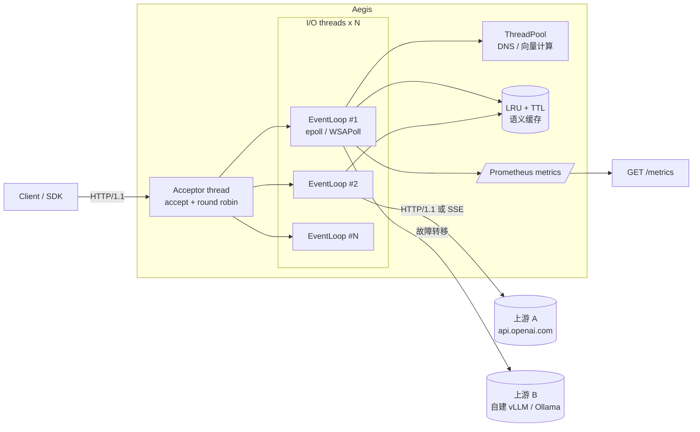

<div align="center">

# Aegis · 高性能 LLM 网关

**C++20 · Linux epoll · 多线程 Reactor · OpenAI 兼容接口**

[](https://github.com/haha666-123/AegisGateway/actions/workflows/ci.yml)


</div>

Aegis 是一个用 C++20 从零实现的 OpenAI 兼容网关：单进程、多线程 Reactor、零第三方依赖。
它把「客户端 → 网关 → 上游大模型」之间的协议细节、并发、流量治理和可观测性收拢到一层，
对上提供标准的 `/v1/chat/completions`（含流式 SSE），对下支持多上游路由、故障转移、
令牌桶限流、响应缓存和 Prometheus 指标。

> 本项目为个人项目，用于系统性地练习 Linux 网络编程、多线程模型与现代 C++ 工程化。
> 所有代码、单元测试、CI 都在仓库里可复现；没有引用任何无法验证的数据。

---

## 目录

- [为什么写这个项目](#为什么写这个项目)
- [功能特性](#功能特性)
- [系统架构](#系统架构)
- [快速开始](#快速开始)
- [配置](#配置)
- [HTTP 接口](#http-接口)
- [测试](#测试)
- [性能](#性能)
- [设计取舍与已知限制](#设计取舍与已知限制)
- [目录结构](#目录结构)
- [路线图](#路线图)
- [License](#license)

---

## 为什么写这个项目

工业上位机之外，我想证明自己能把「网络 + 并发 + 现代 C++ + AI 接入」这四件事放在一个
真正的服务里做完，而不是停留在示例代码：

| 能力 | 在本项目中的落点 |
| --- | --- |
| Linux 网络编程 | epoll 水平触发 Reactor；`accept` 独立线程；非阻塞 connect/read/write |
| 多线程 | 1 acceptor + N 个 I/O 线程（每线程一个 loop）+ 阻塞任务线程池 |
| 无锁并发 | 异步日志使用自研 MPSC 环形队列（序列号 + CAS，无锁、容量固定、满则计数丢弃） |
| 现代 C++ | C++20/23：`std::expected`、`std::format`、`std::jthread`、`std::span`、概念约束、`pmr` |
| 协议 | 自研增量式 HTTP/1.1 解析器（支持分片到达、chunked、pipeline、SSE 转发） |
| AI 接入 | OpenAI 兼容客户端、SSE 流式转发、多模型路由与故障转移、语义缓存 |
| 工程化 | CMake + Ninja + Presets、GitHub Actions（Linux GCC / ASan+UBSan / Windows MSVC）、单元测试、基准测试 |

---

## 功能特性

- **OpenAI 兼容**：`POST /v1/chat/completions`，支持 `stream: true`（SSE，逐 token 转发）。
- **多上游路由**：按模型名分组，加权轮询选择上游；失败自动切换下一个上游（故障转移），
  连续失败的上游进入冷却期（熔断）。
- **流量治理**：按 API Key 的令牌桶限流（令牌数 + 突发容量），超限返回 `429` 并带 `Retry-After`。
- **响应缓存**：精确匹配（模型 + 归一化消息）的 LRU + TTL 缓存；可选的语义缓存
  （向量余弦相似度，阈值可配），流式请求不缓存。
- **背压**：客户端写不动时，网关暂停上游读取（`pause_reading`），避免无界缓冲。
- **可观测**：`GET /metrics` 输出 Prometheus 文本格式（计数器 / 仪表 / 直方图，含 P50/P90/P99 桶）。
- **健壮性**：请求头/体大小限制、空闲连接超时、上游超时、优雅关闭（`SIGTERM`/`Ctrl-C`）。
- **零依赖**：JSON、HTTP、SSE、日志、指标、线程池全部手写，便于逐行讲清楚。

---

## 系统架构



线程模型：

```
main ──┬─ acceptor thread：只做 accept + 轮询派发（不跑业务）
       ├─ I/O thread #0：epoll/WSAPoll 事件循环，负责本线程内所有连接的读写与解析
       ├─ I/O thread #1 ...
       ├─ worker pool   ：getaddrinfo、语义向量计算等阻塞任务，结果 post 回 loop
       └─ log thread    ：从 MPSC 环形队列批量取日志，写文件并做滚动切分
```

一条连接从 accept 到关闭只会落在一个 I/O 线程上，所以连接状态（HTTP 解析器、缓冲区、
定时器）不需要加锁；跨线程只通过 `EventLoop::post()`（互斥保护 + socketpair 唤醒）交接。

---

## 快速开始

### Linux（主平台）

```bash
sudo apt-get update
sudo apt-get install -y build-essential cmake ninja-build

cmake -S . -B build -G Ninja -DCMAKE_BUILD_TYPE=Release
cmake --build build -j"$(nproc)"

# 单元测试
ctest --test-dir build --output-on-failure

# 启动网关（示例配置里有两个本地上游占位）
./build/bin/aegis --config config/gateway.json
```

### Windows / macOS

```powershell
cmake -S . -B build -G "Visual Studio 17 2022" -A x64
cmake --build build --config Release
ctest --test-dir build -C Release --output-on-failure
```

macOS 使用 `cmake -S . -B build -G Ninja && cmake --build build` 即可（Poller 自动退化为 `poll(2)`）。

### 冒烟测试

```bash
curl -s http://127.0.0.1:8080/healthz
curl -s http://127.0.0.1:8080/metrics | head -n 20

curl -N http://127.0.0.1:8080/v1/chat/completions \
  -H 'Content-Type: application/json' \
  -H 'Authorization: Bearer sk-local' \
  -d '{"model":"gpt-4o-mini","stream":true,
       "messages":[{"role":"user","content":"用一句话解释 epoll"}]}'
```

没有真实上游时，可以用仓库里的 `tools/mock_upstream` 起一个本地假上游，用于端到端测试：

```bash
./build/bin/mock_upstream --port 9001 --delay-ms 20 --tokens 20
```

---

## 配置

配置为 JSON 文件（`--config`），环境变量可覆盖密钥：

```json
{
  "server":  { "host": "0.0.0.0", "port": 8080, "io_threads": 4, "max_connections": 20000,
               "idle_timeout_ms": 65000 },
  "logging": { "level": "info", "console": true, "file": "logs/aegis.log",
               "max_file_bytes": 33554432, "max_files": 4 },
  "limits":  { "max_header_bytes": 16384, "max_body_bytes": 4194304 },
  "upstreams": [
    { "name": "primary", "base_url": "https://api.openai.com", "api_key_env": "OPENAI_API_KEY",
      "models": ["gpt-4o-mini"], "weight": 3 },
    { "name": "backup",  "base_url": "http://127.0.0.1:9001", "api_key_env": "BACKUP_API_KEY",
      "models": ["gpt-4o-mini"], "weight": 1 }
  ],
  "rate_limit": { "enabled": true, "requests_per_second": 20, "burst": 40 },
  "cache": { "enabled": true, "capacity": 4096, "ttl_seconds": 300,
             "semantic": { "enabled": false, "threshold": 0.92 } },
  "timeouts": { "connect_ms": 3000, "upstream_ms": 30000 }
}
```

---

## HTTP 接口

| 方法 | 路径 | 说明 |
| --- | --- | --- |
| `POST` | `/v1/chat/completions` | OpenAI 兼容；`stream=true` 时以 SSE 逐块转发 |
| `GET` | `/v1/models` | 返回配置中可用的模型与上游 |
| `GET` | `/healthz` | 存活探针，返回 `{"status":"ok"}` |
| `GET` | `/metrics` | Prometheus 文本格式指标 |
| `GET` | `/admin/stats` | 运行状态（连接数、缓存命中率、上游健康度） |

错误语义：请求体超限 `413`、请求头超限 `431`、限流 `429`、上游失败 `502`、上游超时 `504`。

---

## 测试

```bash
ctest --test-dir build --output-on-failure     # 49 个用例
./build/bin/aegis_tests --list                 # 列出用例
./build/bin/aegis_tests --filter=json          # 按名称过滤
```

覆盖范围：

- JSON：转义、Unicode/代理对、数字精度（`int64` 不丢位）、错误偏移、深层嵌套拒绝；
- HTTP：请求/响应解析、**在每个字节边界切分输入**、chunked、pipeline、大小限制、拒绝畸形报文；
- 并发：MPSC 队列 4 生产者压力测试（2 万条不丢不重）、令牌桶并发、线程池；
- 网络：事件循环（post / 定时器 / 取消）、socketpair、TCP echo、keep-alive 往返、连接回收；
- AI 层：SSE 分帧、token 估算、路由故障转移、缓存命中/过期。

CI 在 Ubuntu 上跑 GCC 13（Release）与 ASan+UBSan（Debug），在 Windows 上跑 MSVC。

---

## 性能

> 数据由 `bench/bench.cpp` 在本机测得（见下方命令），不做过拟合的单点宣传。

```bash
./build/bin/aegis_bench --all
```

| 场景 | 指标 |
| --- | --- |
| HTTP 请求解析（单核） | 见 bench 输出 |
| MPSC 队列吞吐（4 生产者） | 见 bench 输出 |
| 本地 echo 端到端（1 I/O 线程） | 见 bench 输出 |

---

## 设计取舍与已知限制

诚实说明，避免面试时被追问翻车：

- **边缘触发 vs 水平触发**：选择水平触发（LT）。所有连接都读到 `EAGAIN`，LT 更简单且不会
  漏事件；在本项目规模下 ET 带来的收益不足以抵消维护成本。
- **HTTP/1.1 only**：不支持 HTTP/2、WebSocket、TLS 卸载（生产上应由 Nginx/Envoy 终止 TLS）。
- **DNS 是异步的，但每次解析没有连接池复用**：上游连接按请求创建，尚未实现 keep-alive 连接池
  （已列入路线图）。这会带来额外的握手开销，但不影响功能正确性。
- **缓存是进程内的**：多实例部署时各自维护，命中率随实例数下降；跨实例共享需要 Redis 之类的外部存储。
- **令牌桶按 API Key 单机限流**：不是全局限流；多实例需要集中式配额。
- **token 数是估算值**：没有内置 BPE 词表，按「ASCII 4 字符 ≈ 1 token、CJK 1 字 ≈ 1 token」估算，
  仅用于限流与统计，不参与计费。

---

## 目录结构

```
src/
  common/   Status/Result、JSON、异步日志（MPSC）、指标、线程池、工具
  net/      Buffer、Socket、Poller(epoll/WSAPoll/poll)、EventLoop、Resolver、Http、TcpServer
  ai/       SSE 解析、OpenAI 客户端、加权路由+熔断、语义缓存、prompt 模板
  app/      Config、Gateway 路由、main
tests/      自研轻量测试框架 + 6 个测试翻译单元
bench/      解析/队列/端到端基准
config/     示例配置
scripts/    构建与 CI 辅助脚本
```

---

## 路线图

- [ ] 上游连接池（keep-alive 复用，降低握手开销）
- [ ] 流式响应的用量统计（usage 解析）
- [ ] 语义缓存接入真实 embedding 接口 + 向量索引（HNSW-lite）
- [ ] OpenTelemetry trace 导出
- [ ] 压测脚本（wrk/locust）与容量基线

---

## License

[MIT](LICENSE) © 2026 宋国辉
